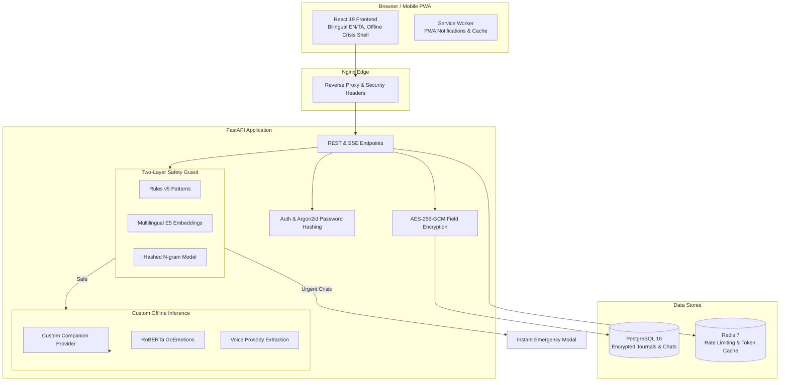

# MindGuard AI

> **Privacy-first, offline-capable mental wellness screening and support web application for Indian college students and young adults, supporting English and Tamil.**

MindGuard AI provides validated clinical self-checks (PHQ-9, GAD-7), an interactive longitudinal score history visualizer, a dedicated 100% custom offline empathetic companion model, daily check-ins with statistical mood correlation patterns, wearable data import (Health Connect & CSV), a wellness toolkit, and an uncompromising crisis safety net connecting individuals in distress directly to verified human helplines (Tele-MANAS, Kiran, Vandrevala Foundation, 112).

---

> [!IMPORTANT]
> **Clinical & Emergency Disclaimer:**
> MindGuard AI is **not** a diagnostic instrument, a licensed psychotherapist, or an emergency response service. Self-assessment scores describe subjective symptom severity over recent weeks and never constitute a medical diagnosis.
> 
> If you or someone you know is in immediate distress or danger:
> - **National Emergency Number:** `112`
> - **Tele-MANAS (Govt of India):** `14416` or `1-800-891-4416` *(24×7, Toll-Free, Multilingual)*
> - **Kiran Mental Health Helpline:** `1800-599-0019`
> - **Vandrevala Foundation:** `9999 666 555` *(Free 24×7 counselling)*

---

## Key Features

- **Validated Clinical Screeners:**
  - **PHQ-9 (Mood Check):** 9 standard items assessing depressive symptom severity with automatic Item 9 crisis escalation.
  - **GAD-7 (Worry Check):** 7 standard items evaluating generalized anxiety levels.
  - **Bilingual Screening Summaries:** Clinician-ready PDF export with dual English and Tamil (`?locale=ta`) contextual explanations.
- **Interactive Longitudinal History:**
  - Responsive **Recharts** score trend chart with instrument toggles (`ALL`, `PHQ-9`, `GAD-7`), clinical severity threshold reference lines, accessible tooltips, and screen-reader data tables.
- **100% Custom Offline Empathetic Companion:**
  - Deterministic, private, in-memory therapeutic AI companion (`CustomCompanionProvider`).
  - Active emotional holding, academic & exam stress cognitive reframing, guided **4-4-4 Box Breathing**, **4-7-8 Sleep Relaxation**, **5-4-3-2-1 Sensory Grounding**, and culturally resonant bilingual Tamil & Tanglish conversational support.
  - **Zero Ollama or external cloud LLM dependencies.**
- **Crisis Safety Net:**
  - Dual-layer safety assessment combining **Rules v5 Regex** (85 patterns across English, Tamil script, and Tanglish) and **Multilingual Semantic Embeddings** (`intfloat/multilingual-e5-small`).
  - Achieves **100% urgent recall (34/34 caught)** on rigorous blind crisis holdouts.
  - Instant modal interception with direct tap-to-call emergency links; urgent messages never reach AI chat generation.
- **Holistic Check-ins & Wearables:**
  - Daily mood tracking, sleep, energy, and journal reflections with encrypted notes.
  - Native **Android Health Connect** / Google Fit daily aggregate JSON and CSV sync for steps and resting heart rate.
- **Voice Check-ins (Non-Verbal Acoustic Prosody):**
  - In-memory 16 kHz mono WAV feature extraction (fundamental pitch F0, RMS loudness, pause-to-speech ratio). Audio is never written to disk.
- **DPDP Act 2023 & Privacy Architecture:**
  - Pseudonymous anonymous sign-up, granular consent management, AES-256-GCM field encryption, zero third-party telemetry, 30-day chat retention limits, one-click GDPR/DPDP JSON data export, account deletion, and an in-app statutory Grievance Redressal mechanism.

---

## Custom Models & Machine Learning Suite

MindGuard runs entirely offline without external model hosting or daemon prerequisites:

1. **Custom Empathetic Companion Model (`CustomCompanionProvider`):**
   - In-process psychiatric conversational agent in [`apps/api/app/chat/providers.py`](apps/api/app/chat/providers.py).
   - Generates contextual, safe, reflective therapeutic responses under 5 ms without GPU requirements.
2. **Safety Engine Layer 1 (Rules v5 Regex Classifier):**
   - 85 high-recall patterns in [`apps/api/app/safety/patterns.yaml`](apps/api/app/safety/patterns.yaml) spanning means, method-seeking, intent, self-harm, and goodbye expressions in English, Tamil, and Tanglish.
3. **Safety Engine Layer 2 (Multilingual Semantic Classifier):**
   - Frozen [`intfloat/multilingual-e5-small`](https://huggingface.co/intfloat/multilingual-e5-small) sentence encoder with a custom trained logistic regression head ([`apps/api/app/safety/embedding_head.json`](apps/api/app/safety/embedding_head.json)). Runs on CPU in ~15 ms.
4. **Safety Fallback (Hashed N-Gram Logistic Model):**
   - Dependency-free 32,768-bucket linear classifier ([`apps/api/app/safety/classifier_weights.json`](apps/api/app/safety/classifier_weights.json)) ensuring fail-safe crisis detection even if neural weights cannot load.
5. **Text Emotion Classifier:**
   - [`SamLowe/roberta-base-go_emotions`](https://huggingface.co/SamLowe/roberta-base-go_emotions) mapped to Ekman 6 primary emotions (joy, sadness, anger, fear, surprise, disgust) + neutral.
6. **Voice Acoustic Prosody Engine:**
   - Windowed autocorrelation and energy thresholding in [`apps/api/app/voice/prosody.py`](apps/api/app/voice/prosody.py).

---

## System Architecture



---

## Quickstart (Docker Compose)

### Prerequisites
- [Docker](https://docs.docker.com/get-docker/) with Compose v2.24+

### 1. Launch the Stack
```bash
# Clone the repository
git clone https://github.com/Kasinathan006/mindguard.git
cd mindguard

# Start services (PostgreSQL, Redis, API, and Web PWA)
docker compose up -d --build
```

### 2. Seed Demo Data (Optional)
```bash
docker compose exec api python -m app.demo_seed
```

### 3. Access the Application
- **Web App:** Open [http://localhost:8080](http://localhost:8080)
- **API Documentation:** Open [http://localhost:8000/docs](http://localhost:8000/docs)
- **Demo Credentials:**
  - Email: `demo@mindguard.example`
  - Password: `demo account only`

*(Or choose **Start anonymously** on the landing page for immediate instant-consent access without an email).*

---

## Local Development Setup

### Backend (Python 3.12 + uv)

```bash
cd apps/api

# Install dependencies using Astral uv
uv sync

# Run database migrations
uv run alembic upgrade head

# Start API dev server
uv run uvicorn app.main:create_app --factory --reload --port 8000
```

### Frontend (React 19 + Vite + TypeScript)

```bash
cd apps/web

# Install dependencies
npm install

# Start Vite dev server with proxy to API
npm run dev
```

---

## Verification & Testing Suite

MindGuard comes with a full automated test suite across all layers:

```bash
# Backend test suite (200 unit, integration, and safety tests)
cd apps/api
uv run pytest

# Safety engine evaluation (Red-team gate & holdout sets)
uv run python ../../ml/safety_eval/evaluate.py --gate

# Frontend unit & component tests (Vitest)
cd apps/web
npm test

# Frontend typechecking
npm run typecheck

# Frontend linting
npm run lint

# End-to-end browser tests (Playwright)
npm run e2e
```

---

## Configuration Reference

Key variables configurable via `.env`:

| Variable | Default | Description |
|---|---|---|
| `APP_ENV` | `development` | Environment mode (`development`, `test`, `production`). Production enforces strict security validation. |
| `LLM_PROVIDER` | `custom` | Primary companion engine (`custom` runs the built-in offline empathetic companion). |
| `SAFETY_CLASSIFIER` | `embedding` | Layer 2 safety classifier (`embedding`, `hashed`, or `none`). |
| `JWT_SECRET` | Development secret | 32+ character entropy string for JWT token signing. |
| `FIELD_ENCRYPTION_KEY` | Development secret | 32-byte URL-safe base64 key for AES-256-GCM journal/chat encryption. |
| `COOKIE_SECURE` | `false` | Enforce HTTPS-only cookie transmission (required in production). |
| `AUTH_RATE_LIMIT_PER_MINUTE` | `30` | Per-IP throttling on authentication endpoints. |
| `WEB_PORT` | `8080` | Host port exposed for web client container. |

---

## Privacy & Compliance (DPDP Act 2023)

MindGuard is architected from the ground up to respect user autonomy and Indian digital privacy laws:
- **Section 6 Consent Notice:** Itemized granular opt-ins for Core Services, Longitudinal Chat History, and Wearables Integration.
- **Section 8 Data Security:** Field-level encryption using AES-256-GCM for personal reflections, voice check-in acoustic metrics, and chat conversations.
- **Section 9 Child Protection:** 18+ gate enforced at onboarding.
- **Section 12 Right to Erasure & Portability:** Single-click full JSON data archive download and permanent account/data deletion.
- **Section 13 Grievance Redressal:** Built-in contact details for the appointed Data Protection Officer / Grievance Officer within the Privacy Center.
- **CERT-In Incident Response Protocol:** Incident mitigation workflows aligning with the CERT-In 6-hour cybersecurity reporting mandate.

---

## Repository Layout

```
mindguard/
├── apps/
│   ├── api/             # FastAPI backend (Python 3.12, SQLAlchemy 2 async, Alembic, PyTorch CPU)
│   │   ├── app/         # Application modules (auth, assessments, chat, checkins, safety, emotion, voice)
│   │   └── tests/       # 200 unit and integration tests
│   └── web/             # React 19 PWA (TypeScript, Vite, Tailwind CSS v4, Recharts, i18next)
│       ├── src/         # UI features, components, and bilingual locales (en / ta)
│       └── e2e/         # Playwright end-to-end multi-viewport test suites
├── ml/                  # Machine learning safety evaluation datasets and training scripts
├── docker-compose.yml   # Multi-container orchestration (api, web, postgres, redis)
├── .env.example         # Template environment configuration
└── README.md            # Comprehensive project documentation and operations guide
```

---

## License

**Copyright © 2026 Kasinathan M. All rights reserved.**

This software, source code, design architecture, custom offline models, and associated documentation are the proprietary property of **Kasinathan M**. Unauthorized copying, modification, distribution, sublicensing, or deployment of this project, in whole or in part, via any medium is strictly prohibited without explicit prior written permission from the author.

PHQ-9 and GAD-7 screeners are reproduced in accordance with the Pfizer PHQ Screeners public clinical use provisions ("no permission required to reproduce, translate, display or distribute").
