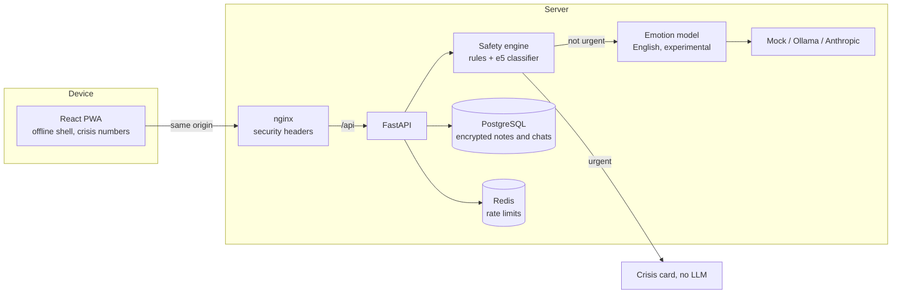

# MindGuard AI

A privacy-first mental wellness **screening and support** web app for Indian college students
and young adults, in English and Tamil. It offers validated self-checks (PHQ-9, GAD-7), a
supportive chat companion that adapts to how you're feeling, daily check-ins with mood patterns,
a wellness toolkit, and a safety net that routes anyone at risk to real human help.

> **MindGuard AI is not a diagnostic tool, a therapist or an emergency service.**
> Screening scores describe how you've been feeling; they are not a diagnosis.
> If you are in danger right now, call **112**, or Tele-MANAS on **14416** / **1-800-891-4416**
> (24×7, free, multilingual).

**Status:** working end to end and tested, but not validated for real users. Read
[docs/SAFETY.md](docs/SAFETY.md) and [docs/FINAL_REPORT.md](docs/FINAL_REPORT.md) first.

## Quickstart

Requirements: Docker with Compose v2.24+.

```bash
cp .env.example .env
docker compose up -d --build --wait          # first build downloads PyTorch and two models
docker compose exec api python -m app.demo_seed
```

Open <http://localhost:8080>. Start anonymously, or sign in to the demo account:

| Email | Password |
|---|---|
| `demo@mindguard.example` | `demo account only` |

The demo account holds 60 days of **synthetic** check-ins and self-checks (every note says it is
synthetic). After the first build the whole stack works offline.

## Architecture



More in [docs/ARCHITECTURE.md](docs/ARCHITECTURE.md).

## Configuration

All variables are documented in [.env.example](.env.example). The important ones:

| Variable | Default | Purpose |
|---|---|---|
| `APP_ENV` | `development` | `production` refuses default secrets |
| `JWT_SECRET`, `FIELD_ENCRYPTION_KEY` | development values | Must be set in production |
| `COOKIE_SECURE` | `false` | Must be `true` in production (HTTPS) |
| `LLM_PROVIDER` | `mock` | `ollama` (local) or `anthropic` (cloud, consent-gated) |
| `SAFETY_CLASSIFIER` | `embedding` | Safety layer 2: `embedding`, `hashed` or `none` |
| `EMOTION_ENABLED` | `true` | English emotion guess in chat |
| `VOICE_ENABLED` | `false` | Experimental voice check-ins |
| `AUTH_RATE_LIMIT_PER_MINUTE` | `30` | Per IP; use 300 for E2E runs |

Deploying to a server: [docs/DEPLOYMENT.md](docs/DEPLOYMENT.md).

## Development

Requirements: Python 3.12 with [uv](https://docs.astral.sh/uv/), Node 22+.

```bash
docker compose up -d db redis

cd apps/api
uv sync
uv run python -m app.safety.download_models   # safety encoder + emotion model, once
uv run alembic upgrade head
uv run uvicorn app.main:create_app --factory --reload

cd apps/web
npm install
npm run dev                                     # http://localhost:5173, proxies /api
```

## Checks

| Area | Command (inside the app folder) |
|---|---|
| API lint, format, types | `uv run ruff check .` · `uv run ruff format --check .` · `uv run mypy` |
| API tests | `uv run pytest` |
| Safety release gate | `uv run python ../../ml/safety_eval/evaluate.py --gate` |
| Emotion evaluation | `uv run python ../../ml/text_emotion/evaluate.py` |
| Web lint, format, types | `npm run lint` · `npm run format:check` · `npm run typecheck` |
| Web unit tests | `npm test` |
| End to end (Compose stack running, `AUTH_RATE_LIMIT_PER_MINUTE=300`) | `npx playwright install chromium` once, then `npm run e2e` |

CI ([.github/workflows/ci.yml](.github/workflows/ci.yml)) runs all of these plus dependency
audits and migration checks.

## Documentation

| Document | Contents |
|---|---|
| [FINAL_REPORT.md](docs/FINAL_REPORT.md) | What is built, tested, and still missing |
| [SAFETY.md](docs/SAFETY.md) | Safety engine design, red-team and blind-holdout metrics, limitations |
| [MODEL_CARDS.md](docs/MODEL_CARDS.md) | Every model, its licence and evaluation |
| [PRIVACY.md](docs/PRIVACY.md) | Data inventory and DPDP Act 2023 mapping |
| [DECISIONS.md](docs/DECISIONS.md) | Every trade-off and deviation, with reasons |
| [DEPLOYMENT.md](docs/DEPLOYMENT.md) | Laptop demo, VPS, model choice, sizing |
| [PITCH.md](docs/PITCH.md) | One-page summary for judges and partners |

## Repository layout

```
apps/api   FastAPI backend (Python 3.12, SQLAlchemy 2 async, Alembic)
apps/web   React 19 PWA (Vite, Tailwind v4, TanStack Query, react-i18next)
ml/        Safety red-team sets and training, emotion evaluation, model cards
docs/      Architecture, decisions, privacy, safety, deployment, reports
```
