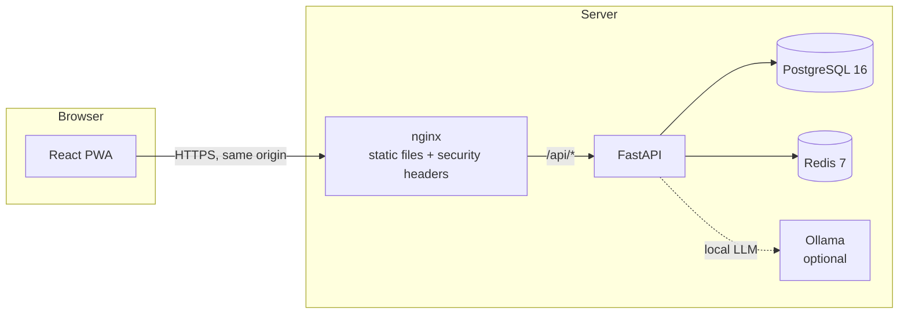

# Architecture

## Overview

The browser only ever talks to one origin. nginx serves the built PWA and reverse-proxies
`/api/*` to FastAPI, so auth cookies are first-party and the CSP can stay `connect-src 'self'`.

## Backend (`apps/api`)

- **App factory.** `app.main.create_app(settings, resources_factory)` builds the app. Uvicorn
  runs it with `--factory`, so importing modules never opens connections or reads secrets.
- **Resources.** The DB engine, session factory and Redis client are created once in the
  lifespan (`app.core.resources`) and reached through typed FastAPI dependencies
  (`app.core.deps`). Tests swap in in-memory SQLite and fakeredis through the same factory.
- **Configuration.** `app.core.config.Settings` (pydantic-settings) reads environment variables.
  `.env.example` lists every variable.
- **Logging.** JSON lines to stdout. A filter redacts emails and phone numbers as a second line of
  defence; handlers are written to log identifiers and outcomes, never user content.
- **Migrations.** Alembic (async) in `app/db/migrations`. The container runs
  `alembic upgrade head` before starting Uvicorn.
- **Domain modules** (added phase by phase): `auth`, `consent`, `assessments`, `safety`, `chat`,
  `emotion`, `voice`, `mood`, `reports`, `wellness`, `integrations`, `privacy`. Each owns its
  models, schemas, service functions and router.

## Frontend (`apps/web`)

- Feature folders under `src/features/*`, shared primitives in `src/components/ui`, and
  infrastructure (API client, i18n) in `src/lib`.
- TanStack Query owns server state; the API client always sends credentials and raises a typed
  `ApiError`.
- `react-i18next` with `en` and `ta` locales from day one.

## Runtime topology (Docker Compose)

| Service | Image | Notes |
|---|---|---|
| `db` | postgres:16-alpine | Named volume `db-data` |
| `redis` | redis:7-alpine | Persistence disabled; rate limits and session cache only |
| `api` | `apps/api/Dockerfile` | Non-root user, health-checked |
| `web` | `apps/web/Dockerfile` | nginx, security headers, SSE-friendly proxy |
| `ollama` | ollama/ollama | Only with `--profile ollama` |
