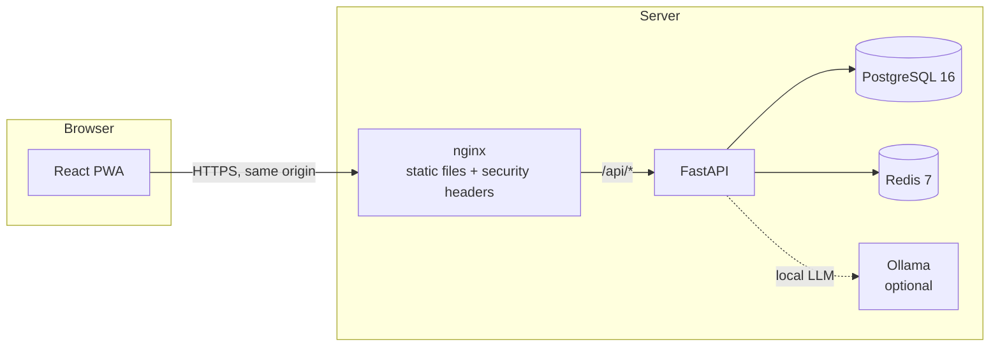

# Architecture

## Overview

The browser only ever talks to one origin. nginx serves the built PWA and reverse-proxies
`/api/*` to FastAPI, so auth cookies are first-party and the CSP can stay `connect-src 'self'`.

## Backend (`apps/api`)

- **App factory.** `app.main.create_app(settings, resources_factory)` builds the app. Uvicorn
  runs it with `--factory`, so importing modules never opens connections or reads secrets.
- **Resources.** The DB engine, session factory and Redis client are created once in the
  lifespan (`app.core.resources`) and reached through typed FastAPI dependencies
  (`app.core.deps`). Tests swap in in-memory SQLite and fakeredis through the same factory.
- **Configuration.** `app.core.config.Settings` (pydantic-settings) reads environment variables.
  `.env.example` lists every variable.
- **Logging.** JSON lines to stdout. A filter redacts emails and phone numbers as a second line of
  defence; handlers are written to log identifiers and outcomes, never user content.
- **Migrations.** Alembic (async) in `app/db/migrations`. The container runs
  `alembic upgrade head` before starting Uvicorn.
- **Domain modules** (added phase by phase): `auth`, `consent`, `assessments`, `safety`, `chat`,
  `emotion`, `voice`, `mood`, `reports`, `wellness`, `integrations`, `privacy`. Each owns its
  models, schemas, service functions and router.

## Sessions and consent

- **Anonymous first.** `POST /auth/anonymous` creates a user with no email, after an 18+
  confirmation and `core` consent in the same request. `POST /auth/upgrade` later attaches an
  email and argon2id password hash to the same row, so every record keeps its `user_id`.
- **Tokens.** A 15-minute HS256 access JWT lives in an httpOnly `SameSite=Strict` cookie scoped to
  `/api`. A 30-day opaque refresh token lives in a second cookie scoped to `/api/v1/auth`; only its
  SHA-256 digest is stored. Every refresh rotates the token within a family, and presenting an
  already-rotated token revokes the whole family.
- **Consent.** One row per user and scope holds the current state; `audit_log` records every grant
  and revoke. Endpoints that depend on optional data use the `require_consent(scope)` dependency,
  which returns `403 {"code": "consent_required"}` until the scope is granted.
- **Rate limiting.** Credential and session-creation endpoints share a Redis fixed-window limiter
  keyed by a hash of the client IP.

## Self-checks and the crisis flow

- **Scoring is deterministic.** `app/assessments/instruments.py` holds the verbatim items and
  published bands; `scoring.py` validates answer count and range (0-3, integers only) and returns
  total, band, next step and whether PHQ-9 item 9 is positive. No model is involved.
- **Safety events are content-free.** `safety_events` records source, level, detector and the IDs of
  the resources shown. It has no column that could hold an answer or a message.
- **Crisis resources** live in the human-reviewed `app/safety/resources.yaml` and are served
  publicly at `GET /safety/resources`. A test fails CI when any entry's `last_verified` is older
  than 180 days or when a description claims confidentiality.
- **The crisis card** is one fixed component (`features/crisis/CrisisCard.tsx`) used in the global
  "Need help now?" dialog, the questionnaire and the result screen. It renders the bundled copy
  immediately and swaps in the API's version when it arrives.

## Safety engine

`app/safety/engine.assess(text)` runs before any LLM call and returns `none`, `elevated` or
`urgent` plus the detector and matched rule IDs, never the text. Layer 1 is the versioned
multilingual rule file `patterns.yaml`; layer 2 is a sentence-encoder classifier
(`SAFETY_CLASSIFIER=embedding`, with a dependency-free `hashed` fallback). The two are
OR-combined. The classifier is loaded once in the app lifespan. Method, metrics and limitations:
[SAFETY.md](SAFETY.md).

## Frontend (`apps/web`)

- Feature folders under `src/features/*`, shared primitives in `src/components/ui`, and
  infrastructure (API client, i18n) in `src/lib`.
- TanStack Query owns server state; the API client always sends credentials and raises a typed
  `ApiError`.
- `react-i18next` with `en` and `ta` locales from day one; a unit test keeps their keys identical.
- `apiFetch` retries once after a silent `/auth/refresh` when a request returns 401, sharing one
  refresh between concurrent callers.
- Design tokens are CSS variables (light, dark, and a manual override via `data-theme`); fonts are
  self-hosted. Motion uses `motion/react` and always honours `prefers-reduced-motion`.
- Playwright E2E runs against the Compose stack at 360 px and desktop widths, with an axe-core
  WCAG 2.2 AA scan on every screen it visits.

## Runtime topology (Docker Compose)

| Service | Image | Notes |
|---|---|---|
| `db` | postgres:16-alpine | Named volume `db-data` |
| `redis` | redis:7-alpine | Persistence disabled; rate limits and session cache only |
| `api` | `apps/api/Dockerfile` | Non-root user, health-checked |
| `web` | `apps/web/Dockerfile` | nginx, security headers, SSE-friendly proxy |
| `ollama` | ollama/ollama | Only with `--profile ollama` |
